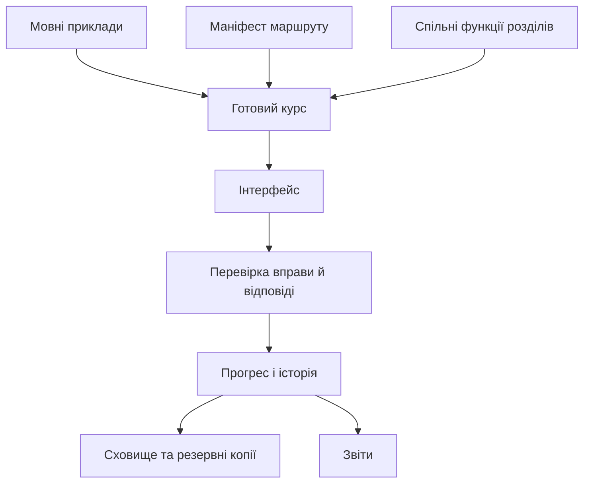

# Як влаштований код

lingva.lab — один статичний сайт на HTML, CSS і JavaScript. Навчальні матеріали, перевірка відповідей і відображення сторінки мають окремі модулі. Пакети для розробки не потрапляють до готового сайту.

## Від матеріалів до сторінки

`content/registry.js` поєднує маніфест маршруту з його мовними матеріалами. Результат — готовий курс зі списком розділів і вправ. Перевірка отримує вправу та відповідь і повертає результат. Інтерфейс показує результат і передає його модулю прогресу.



Матеріали та перевірка не звертаються до елементів сторінки. Модулі `src/learning/`, `src/tools/` та `src/persistence/` можна перевіряти без відкритого браузера. Для регулярних виразів використовується окремий Worker з обмеженням часу; робота з DOM залишається в `src/ui/` і `src/main.js`.

## Каталоги

| Шлях                                                 | Призначення                                                                                 |
| ---------------------------------------------------- | ------------------------------------------------------------------------------------------- |
| `index.html`, `styles/main.css`                      | Каркас і дизайн сайту                                                                       |
| `content/tracks/{de,fr,en}/language.js`              | Приклади, слова, тексти, мовні значення                                                     |
| `content/tracks/{de,fr,en}/foundations.js`           | Незалежні програми трьох базових маршрутів                                                  |
| `content/shared/chapters/`                           | Спільні функції, які створюють вправи з мовних прикладів                                    |
| `content/shared/builders.js`                         | Невеликі помічники авторів: `defineChapter`, `adaptChapter`, `choice`, `exact`, `portfolio` |
| `content/schema.js`, `registry.js`                   | Перевірка матеріалів, реєстрація та пошук маршрутів                                         |
| `content/sources.js`, `glossary.js`, `challenges.js` | Джерела, терміни та приховані виклики                                                       |
| `src/main.js`                                        | Запуск, маршрути, події користувача, з’єднання модулів                                      |
| `src/learning/`                                      | Перевірка відповідей, прогрес, XP, знімки спроб                                             |
| `src/tools/`, `src/workers/`                         | Симулятори, аналіз тексту й аудіо, ізоляція regex                                           |
| `src/ui/pages/`, `src/ui/exercises/`                 | HTML сторінок, редактори та браузерні взаємодії                                             |
| `src/persistence/`                                   | Перевірка резервних копій, міграції та завантаження локального прогресу                     |
| `src/features/`                                      | Час роботи й окреме сховище відгуків                                                        |
| `src/reports/`                                       | Дані звіту та його HTML-подання                                                             |
| `src/i18n/`                                          | Український словник і функції вибору тексту інтерфейсу                                      |
| `scripts/`, `tests/`                                 | Збірка, перевірка матеріалів, модульні й браузерні тести                                    |

## Три способи авторства

### Спільний розділ, різні приклади

Маніфест імпортує спільну функцію. Реєстр передає їй матеріали потрібної мови:

```js
import unicode from "../../shared/chapters/unicode.js";

export default {
  id: "fr-foundations",
  language: "fr",
  level: "foundations",
  revision: 1,
  title: "Французька / Основи",
  chapters: [unicode],
};
```

Щоб замінити французький приклад, редагуйте `content/tracks/fr/language.js`. Німецькі матеріали, редактор і облік прогресу змінювати не потрібно.

### Явна адаптація для однієї мови

У файлі `content/tracks/fr/chapters/unicode.js`:

```js
import base from "../../../shared/chapters/unicode.js";
import { adaptChapter } from "../../../shared/builders.js";

export default adaptChapter(base, (chapter) => ({
  ...chapter,
  tasks: chapter.tasks.map((task) =>
    task.id === "unicode-spelling-audit"
      ? { ...task, revision: 2, prompt: "Нові умови французької вправи…" }
      : task,
  ),
}));
```

Потім маніфест французького маршруту імпортує цю адаптацію. Інші маніфести продовжують використовувати спільну функцію. Це явне створення об’єкта; прихованого злиття вкладених налаштувань немає.

### Власний розділ

```js
import { defineChapter, exact } from "../../../shared/builders.js";

export default defineChapter({
  id: "french-research",
  revision: 1,
  title: "Власне дослідження",
  short: "Перевіряємо мовні дані",
  category: "ДОСЛІДЖЕННЯ",
  time: 30,
  outcome: "Пояснювати одиницю аналізу",
  case: "Потрібно документувати власну добірку текстів.",
  theory: "Спочатку визначте, що саме рахуєте, і запишіть це рішення.",
  sources: [],
  terms: [],
  tasks: () => [
    exact(
      "french-research-format",
      "Формат таблиці",
      "Назвіть текстовий формат таблиці з комами як роздільниками.",
      "CSV",
      "CSV зберігає записи як рядки, а поля розділяє комами.",
      "Згадайте формат із розділу про дані.",
    ),
  ],
});
```

Це приклад структури, а навчальний зміст перед публікацією потребує перевірки викладачем. Маніфест також приймає повністю описаний об’єкт розділу. Новий розділ можна вставити в будь-яку позицію без зміни ID решти вправ.

## Незалежні маршрути й рівні

Порядок, назви, кількість розділів і набір обов’язкових вправ визначає обраний маніфест. `required: false` у вправі дозволяє додаткову практику; така вправа не блокує завершення розділу та появу відгуку. Необов’язковий розділ також може мати `required: false`. Для завершення всього курсу потрібні лише обов’язкові розділи. У кожному розділі має бути хоча б одна обов’язкова вправа.

Повний поглиблений курс може мати ID `de-advanced`, власний маніфест і порядок розділів. Його потрібно додати до реєстру. Прогрес розділено за ID маршруту, тому базовий і поглиблений курси однієї мови не ділять відповіді та XP. Назви рівнів беруться зі словника; для нового рівня слід додати відповідний ключ.

`interfaceLocale` задає мову інтерфейсу, `activePathId` — навчальний маршрут. Наразі підтримується лише `uk`; вибір англійських матеріалів не перемикає кнопки на англійську. Тривалі навчальні пояснення залишаються українськими. Перед додаванням іншого інтерфейсу їх теж потрібно винести до словників.

## Межі модулів

- Матеріали можуть використовувати помічники авторів, але не імпортують UI, сховище або сторінку.
- `checkAnswer(exercise, answer)` повертає Promise з результатом. Вона не зберігає даних і не змінює сторінку; для regex запускає ізольований Worker. Внутрішня `evaluateTask` порівнює отримані дані з критеріями вправи.
- Прогрес приймає результат перевірки. Тексти подань і вибрані варіанти зберігаються як подані студентом.
- UI відповідає за DOM, аудіовідтворення, завантаження файлів і події. Складання звіту та його HTML-форматування відокремлені від кнопки завантаження.
- Відгуки зберігаються окремо від навчальних записів і не додаються до звітів або резервних копій прогресу.
